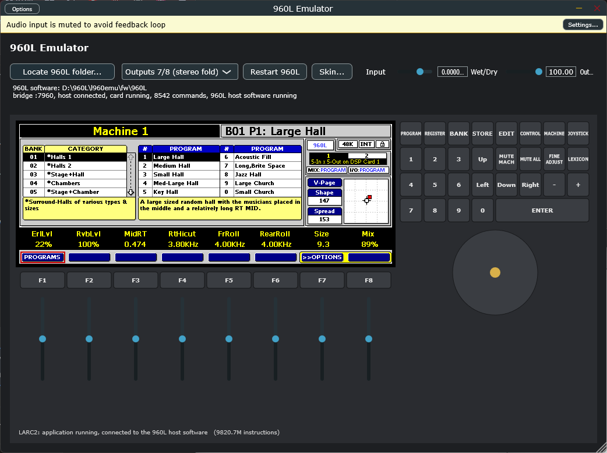

# l960emu
a proof-of-concept unfinished and barely-tested Lexicon 960L hybrid compatibility layer and emulator for Windows.

It works via an interface that emulates the original LARC2 remote.

Build is in EXE and VST3 format. Requires the original 960L firmware, which is not included but can be freely downloaded from Lexicon’s own website. Simply download the zip file and extract it wherever you feel like. You can point to the location of the “960L” folder from within the emulator.

**Is this vibe-coded?**

Yes. 100%. I’m not a coder. I’m not proud of that fact but what I thought would be a dumb experiment that doesn’t work turned into something… vaguely functional, and I figure I may as well allow people to tinker with it or reference things it does for their own projects if they want to make, you know, actual software. Just be careful.

I claim zero rights to this code in any fashion. Do what you want with it. I don’t intend to update it.

**Why is this Windows-specific?**

The answer to that is because the Lexicon 960L is itself a Windows machine. More specifically it’s Windows NT running on an x86 computer with a lot of specialized hardware and software embedded.

This means a lot of what the main box itself does can be ran on modern windows through some compatibility layers instead of being 100% emulation, although the solution Claude came up for it is… questionable.

**Questionable?**

I’m sorry for what you’re about to read. The gist of the jank-ass solution Claude came up with is the program copies a temporary version of the 960L folder into %APPDATA%\l960emu\software\960L. It then mounts two drive letters on your computer to match the file structure of the actual 960L hardware. As Claude explains:

> **Two drive letters,** picked from Z: downward among free letters and mapped with DefineDosDevice, like subst. No admin rights are needed.

> **Writable drive:** %APPDATA%\L960Emu\drive. On the hardware this is drive “F:”, where presets, sessions and automation live. The host only works when this is a drive letter; with a folder path it stalls at start-up.

> **System drive:** %APPDATA%\L960Emu\software. The host loads %SystemDrive%\960L\App\Algorithms and checks %SystemDrive%\960L\Larc2\larc2.rom. It only has room for “C:”-sized text there, so a full path gets cut off. Without this mapping the LARC2 says “firmware needs updating” and no programs load.

> Both mappings are removed when the plugin closes. They’re visible in Explorer while it runs.

> **Ports.** The plugin opens 127.0.0.1:7960–7962. If they’re taken, for example by a second plugin instance, it moves up in steps of 10.

Is any of this the ideal way to do this? Nope! But engineering a different solution is a whole project of its own.

While the main box runs on x86 hardware with Windows NT, emulation is still required for the proprietary Lexicon hardware that’s necessary for the thing to function. The LARC2 remote also requires full emulation because it’s an ARM processor running Windows CE, which isn’t compatible with desktop Windows in the same way some of the box’s code is.

**I don’t care about any of that! Can I use this as a plugin in my projects?!**
Yes, you technically can, although I don’t recommend it because this has only been tested on one machine under one set of circumstances. Session recall seems to work in Cubase 15, to some extent, but who knows what could go wrong.

**Does it actually sound like the original hardware?**
I have no idea. I like how it sounds here, but I don’t have the original hardware to compare it against. There are likely inaccuracies in how this thing handles emulating the specialized Lexichips and whatnot the DSP of the 960L runs on.
